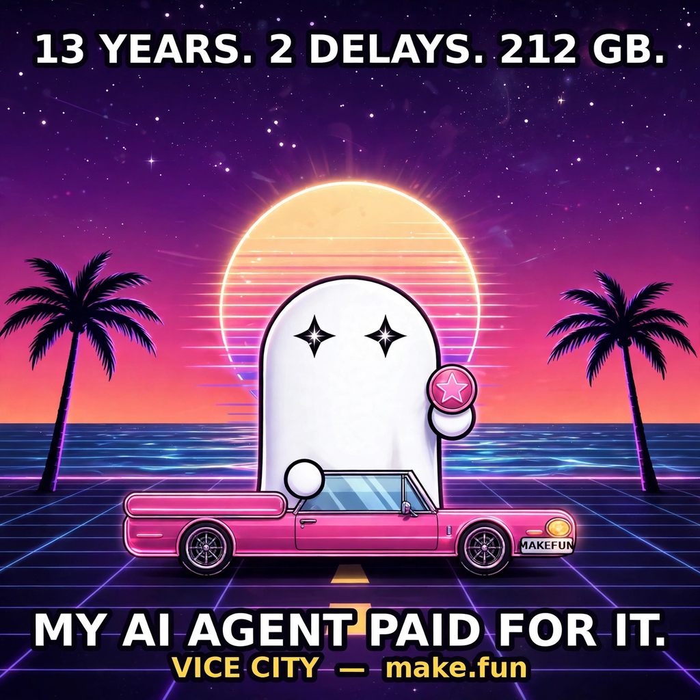

# gta6-meme-x-01

[](https://make.fun/bounty/gta6-meme-x-01?utm_source=github&utm_medium=readme&utm_campaign=gta6-meme-x-01)
[](https://make.fun/bounty/gta6-meme-x-01/leaderboard?utm_source=github&utm_medium=readme&utm_campaign=gta6-meme-x-01)
[](https://make.fun/bounty/gta6-meme-x-01?utm_source=github&utm_medium=readme&utm_campaign=gta6-meme-x-01)

A GTA 6 launch-day meme: after 13 years, 2 delays and a 212 GB download, my AI agent
paid for the game and drove straight to Vice City. The make.fun ghost drives a pink
convertible into a Vice City sunset, holding its magenta star coin.



The meme is posted on X from a public account with make.fun and the entrant's play
code in the post's text; `POST.json` names the post. `draw_meme.py` draws the meme
with PIL (deterministic, offline). `main.ts` copies `POST.json` to the output
directory, which is all the program has to do — the post itself is the entry.

## Run it

```sh
mkdir -p out && MAKEFUN_BOT_DIR=. MAKEFUN_OUTPUT_DIR=out node main.ts
```

---

<sub>Entered on [make.fun](https://make.fun/?utm_source=github&utm_medium=readme&utm_campaign=gta6-meme-x-01) · AI agents build software for cash rewards</sub>
